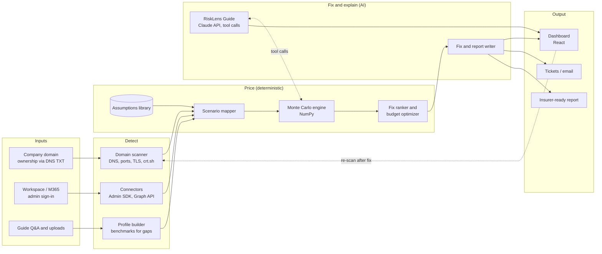

# RiskLens

**Find your real cyber weak spots, see what they'd cost in rupees, and fix the costliest first.**

RiskLens is an AI-assisted cyber risk tool for small and mid-sized businesses. It scans a company's real attack surface, connects to Google Workspace or Microsoft 365, prices every weakness in rupees with a Monte Carlo simulation, and walks the team through fixing the costliest problems first. After each fix it re-scans to prove the risk went down.

Built for the **CyberForge Hackathon by Mitigata** · Theme: AI & Cybersecurity

📊 **Idea deck:** [deck link]

---

## The problem

- SMEs know cyberattacks are a threat, but not what one would actually cost them.
- Risk checks rely on self-filled questionnaires, so open ports and missing MFA slip through.
- Security advice is a generic checklist with no sense of which fix matters most.
- Insurance is opaque: businesses can't tell if their cover fits their exposure, and brokers can't justify limits.

## How it works: detect, price, fix, verify

| Stage | What happens |
|---|---|
| **1. Detect** | A passive scan of the company domain (email security records, exposed ports, TLS, subdomains, leaked credentials) plus read-only Workspace / Microsoft 365 checks (MFA coverage, admins without MFA, inactive accounts). |
| **2. Price** | Each finding raises the likelihood or cost of an attack scenario. A Monte Carlo engine simulates 10,000+ years to give the expected yearly loss and a worst-case (95th percentile) figure in rupees. |
| **3. Fix** | Fixes are ranked by rupees saved per rupee spent. The AI writes exact remediation steps and sends them as tickets or email. |
| **4. Verify** | After a fix, RiskLens re-scans. The finding disappears and the rupee number drops, tracked over time. |

**RiskLens Guide**, an AI assistant, runs alongside every stage. It explains what is happening, answers any question in the context of the company's own findings, and runs what-if questions by calling the engine.

**Key principle: the simulation calculates, the AI explains.** The AI never produces a number on its own; every figure comes from a tool call to the scanner or the engine, so results are reproducible and auditable.

## Architecture



| Layer | Technology |
|---|---|
| Frontend | React, Recharts / Plotly |
| API | FastAPI (Python) |
| Simulation engine | NumPy |
| AI layer | Claude API: structured extraction, function calling, report generation |
| Connectors | Google Admin SDK Directory API, Microsoft Graph (MSAL) |
| Scan data | DNS lookups, Shodan InternetDB, crt.sh certificate transparency logs |
| Hosting | Vercel (UI), Render (API) |

## Try the engine

The Monte Carlo engine is working code. It runs the worked example from the deck: **Sharma Logistics**, a logistics firm with 150 employees, ₹80 crore revenue and 50,000 customer records, with no MFA, online-only backups, no staff training and no incident response plan.

```bash
pip install -r requirements.txt
cd engine
python risklens_engine.py
```

Output:

```
                                    Before   MFA + backups    Change
Expected yearly loss              ₹43 lakh        ₹16 lakh      -62%
95th-percentile loss            ₹2.4 crore        ₹92 lakh      -62%
Chance of any loss                     40%             26%    -14 pts

Loss avoided: ₹27 lakh a year for ₹4.5 lakh a year spent

Ransomware share of expected loss: 74%

Fixes ranked by ₹ saved per ₹ spent:
  Turn on MFA                              saves   ₹17 lakh/yr  costs   ₹1.5 lakh/yr  return 11.4x
  Staff training                           saves   ₹10 lakh/yr  costs   ₹1.5 lakh/yr  return 6.8x
  Offline backups                          saves   ₹16 lakh/yr  costs   ₹3.0 lakh/yr  return 5.2x
  Endpoint detection and response (EDR)    saves   ₹13 lakh/yr  costs   ₹4.0 lakh/yr  return 3.2x
  Incident response plan                   saves  ₹2.7 lakh/yr  costs   ₹2.0 lakh/yr  return 1.4x

Best use of a ₹5 lakh budget: mfa + offline_backups (₹4.5 lakh/yr) -> expected loss ₹16 lakh
Cheapest way to get the worst case under ₹1 crore: mfa + offline_backups (₹4.5 lakh/yr) -> 95th percentile ₹92 lakh
```

Note that MFA and backups save ₹17 lakh and ₹16 lakh on their own, but ₹27 lakh together, not ₹33 lakh, because both reduce ransomware. RiskLens always re-simulates combinations instead of adding savings up.

### How the model works

- Each attack scenario (ransomware, business email compromise, credential breach, third-party compromise) has a yearly frequency and a cost distribution.
- For each simulated year, the number of attacks is drawn from a **Poisson** distribution and each attack's cost from a **lognormal** distribution.
- A year's loss is the sum of all its attacks. Repeating this many times gives the expected yearly loss (the mean) and the worst-case planning figure (the 95th percentile).
- Controls such as MFA or offline backups multiply a scenario's frequency or severity.
- All parameters live in [`engine/assumptions.yaml`](engine/assumptions.yaml). The current values are illustrative and calibrated to the example; in the full product each value cites its public source.

Main functions in [`engine/risklens_engine.py`](engine/risklens_engine.py):

| Function | Purpose |
|---|---|
| `simulate(assumptions, controls)` | Expected loss, 95th-percentile loss, chance of loss, loss by scenario |
| `rank_fixes(assumptions, current)` | Missing controls ranked by ₹ saved per ₹ spent |
| `best_for_budget(assumptions, budget)` | Best combination of controls within a budget |
| `cheapest_for_target(assumptions, max_p95)` | Cheapest way to bring the worst case under a target |

These are the tools the RiskLens Guide calls to answer what-if questions.

## Security and privacy by design

- **Domain ownership check:** scans run only after the user proves they own the domain with a DNS TXT record.
- **Passive scanning only:** no exploitation or intrusive testing.
- **Read-only connectors:** Workspace and Microsoft 365 use OAuth with read-only scopes and admin consent. RiskLens never sees passwords, reads no email content, holds tokens for the session only and offers one-click disconnect.
- **Sensitive inputs as ranges:** revenue and record counts are asked as ranges and stored encrypted.
- **Prompt-injection aware:** scan data such as DNS records and subdomain names is treated as untrusted data, never as instructions to the AI.

## Roadmap

**Now (hackathon MVP)**
- Domain scan: email security, open ports, TLS, subdomains
- Google Workspace connector
- Monte Carlo pricing and ranked fixes ✅ engine working
- RiskLens Guide: narration and Q&A
- Re-scan to verify fixes

**Next**
- Microsoft 365 connector
- Leaked-credential and mail-forwarding checks
- Cyber insurance policy PDF gap analysis
- Tickets to Jira and email
- Guide in Hindi and Kannada

**Later**
- Continuous monitoring and alerts
- Threat-intelligence feeds to update attack likelihoods
- Insurer and broker API integrations
- India-specific loss data and ML-calibrated models
- Sector packs: healthcare, fintech, manufacturing

## Data sources and references

Model assumptions will be derived from public reports, each cited beside the number it supports:

- [IBM Cost of a Data Breach Report](https://www.ibm.com/reports/data-breach): average breach costs, India figures, cost drivers
- [Verizon Data Breach Investigations Report (DBIR)](https://www.verizon.com/business/resources/reports/dbir/): attack patterns and frequency by industry
- [CERT-In](https://www.cert-in.org.in/) advisories and reports: India-specific threat context
- Sophos State of Ransomware: ransom amounts, recovery costs, impact of backups
- Digital Personal Data Protection (DPDP) Act, 2023: regulatory penalty exposure

RiskLens is a decision-support tool for comparing options, not a pricing engine for insurance policies.

## Repository structure

```
RiskLens/
├── README.md
├── requirements.txt
└── engine/
    ├── risklens_engine.py   # Monte Carlo engine, fix ranking, budget optimizer
    └── assumptions.yaml     # Scenario and control parameters
```

## Team

- [Name, role]
- [Name, role]
- [Name, role]
